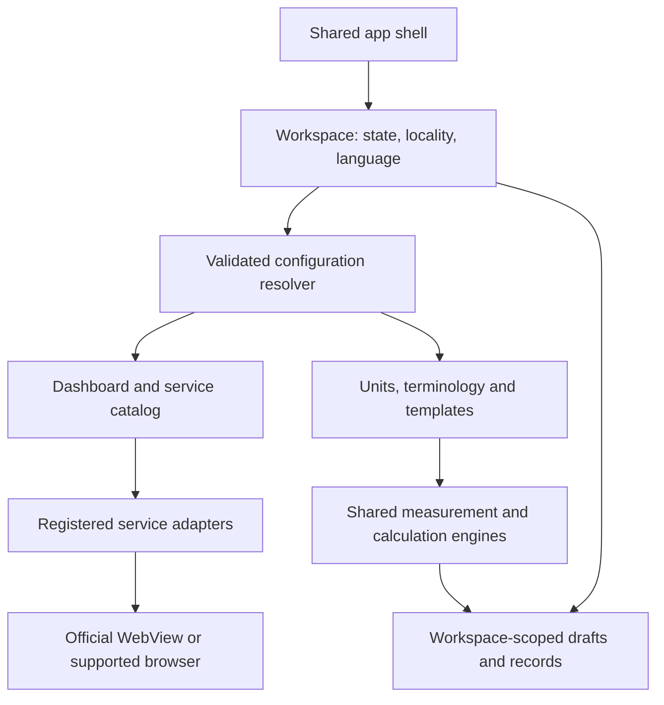

# Lekhpal: configuration-driven all-India design

Date: 9 October 2026  
Status: Architecture direction accepted; detailed rollout gates remain open.  
Original scope: Repository analysis, reference-app comparison and proposed design.

Follow-up: The user accepted bundled JSON and a Hindi-first group of UP, MP, Bihar, Delhi and Rajasthan. The configuration foundation is now implemented; state switching remains gated. See [Hindi-first rollout status](HINDI_STATE_ROLLOUT.md) for completed work, evidence and remaining implementation. That agreed state order supersedes the pilot suggestions in this original analysis.

## 1. Recommendation

Yes. The app can serve every Indian state and union territory through one shared application, with configuration selecting the appropriate services, terminology, local units and dashboard content. The current release is UP-first, but several foundations for multi-state support already exist.

Use **a shared app + versioned state configuration + tested service adapters**. Configuration should describe what is available; adapters should implement differences in browser behavior and workflows. Changing only portal URLs, or enabling the existing state-selection flag, would not establish complete state support.

Preserve the existing UP experience as the first adapter and regression baseline. Add other states incrementally. National availability should mean that users can select their region and access the tools and services actually supported there, with coverage described honestly. It should not imply identical government services in every state.

## 2. What the current repository already supports

| Area | Current evidence | Design implication |
| --- | --- | --- |
| UP-first release | [`releaseFeatures.ts`](../src/config/releaseFeatures.ts) sets `multiState: false` and resolves the workspace to UP. | This is a rollout restriction, not a requirement to rebuild the app. |
| Retained state selection | [`SelectedStateContext.tsx`](../src/context/SelectedStateContext.tsx) preserves the saved choice; [`StateSelectionScreen.tsx`](../src/screens/StateSelectionScreen.tsx) provides the picker. | Reuse the foundation after migration and navigation checks. |
| State/UT catalog | [`stateDashboardCatalog.ts`](../src/data/stateDashboardCatalog.ts) contains entries for all 36 states/UTs. | Catalog coverage is already broad; actual service coverage needs separate evidence. |
| Portal directory | [`statePortalCatalog.ts`](../src/data/statePortalCatalog.ts), [`nationalPortalLinks.ts`](../src/data/nationalPortalLinks.ts) and [`stateOfficialPortalCatalog.ts`](../src/data/stateOfficialPortalCatalog.ts) contain state-specific links. | Consolidate responsibility gradually; do not replace tested flows with a generic link list. |
| Dashboard | [`StateDashboardScreen.tsx`](../src/screens/StateDashboardScreen.tsx) has shared tools and UP-specific daily portals. | Keep the shared layout; make service selection and ordering configurable. |
| Portal navigation | [`upEntryNavigation.ts`](../src/navigation/upEntryNavigation.ts) handles both generic links and special UP behavior. `StatePortalEntry` also depends on a UP entry type. | Introduce a state-neutral service contract around existing behavior. |
| Records and drafts | [`workspaceStorage.ts`](../src/utils/workspaceStorage.ts), [`DeskContext.tsx`](../src/context/DeskContext.tsx) and measurement drafts already use state-scoped storage. | Extend provenance and switch safety rather than discard existing records. |
| Measurement | [`measurement.ts`](../src/domain/measurement.ts) separates standard area units from supplied Bigha/Biswa factors. | Reuse common geometry; expand local unit profiles with verified regional rules. |
| Language | [`tool.ts`](../src/types/tool.ts) currently defines English/Hindi localized text. | State coverage and language coverage must be planned separately. |

The existing [`MULTI_STATE_ROLLOUT.md`](MULTI_STATE_ROLLOUT.md) records the temporary UP-first decision. Its historical reference to guest entry should not be interpreted as a request to restore guest authentication.

Two current implementation details deserve attention before enabling selection:

- `hasLiveStateWorkspace` considers the presence of catalog blocks sufficient for a live workspace. This is not evidence that a service's complete workflow works.
- Some portal entries are deduplicated by URL. Two distinct services can share an entry URL and still require different launch actions. Service identity must not be determined solely by URL.

This is a targeted architecture review, not a complete audit of every screen, backend or government website.

## 3. Reference: LEKHPAL (Fast Work)

The exact reference supplied by the user is [LEKHPAL (Fast Work), by Technical ASK, on Google Play](https://play.google.com/store/apps/details?id=com.lekhapal5441.app&hl=en_IN). Its description presents direct access to government land-record websites, lists sources from multiple states and identifies the product as independent of government. Its release notes advertise all-India data coverage and quicker access to selected UP services.

That supports a useful product direction: a common entry point with regional services and frequently used shortcuts. It does **not** establish that every state has equal functionality, or reveal the competitor's architecture, state-switch behavior, unit rules or reliability. The competitor was not installed or interactively tested for this analysis. Retrieved locale variants differed in update metadata, so no release-date conclusion is used here.

Our proposed differentiation is a consistent workspace that combines official service access with measurement, simultaneous conversions, saved work and clear regional context. This is a design recommendation, not a claim about functionality missing from the competitor.

## 4. Why state selection needs more than different links

The Department of Land Resources describes land records as maintained by state/UT revenue departments and publishes a state-wise directory. Some entries have no RoR link in that directory; absence there is not proof that no regional service exists. Each jurisdiction needs its own verified service inventory. [Source: DoLR citizen services](https://dolr.gov.in/en/citizen-centric-services/).

| Example | Evidence and resulting design need |
| --- | --- |
| Uttar Pradesh | Our approved flows distinguish Khatauni Copy, Certified Copy, Plot Sale Status and Plot Dispute Status, despite shared portal infrastructure. Preserve their separate launch actions. [Project baseline](approved-bhulekh-baseline.md). |
| Maharashtra | The government district service directory distinguishes 7/12, 8A, property cards, digitally signed documents and other services. Preserve document and service distinctions rather than naming everything Khatauni. [Official service directory](https://mumbaisuburban.gov.in/en/services-2/). |
| Tamil Nadu | The official portal distinguishes Patta/Chitta, A-register, field maps and urban land records. Its rural/urban distinction should be represented in service configuration. [Official portal](https://eservices.tn.gov.in/eservicesnew/home.html). |

These sources establish service names and categories, not successful end-to-end access from our app. Maharashtra's linked Bhulekh endpoint timed out during one research fetch; its directory entry must not be treated as live workflow verification.

## 5. Proposed user experience

1. **New user:** keep the existing authentication flow, then select a state/UT when multi-state rollout is enabled. Ask for a district or more precise locality only when a service or local unit rule requires it.
2. **Existing UP user:** continue opening the UP dashboard directly. Introduce an unobtrusive state-change control rather than force a new onboarding journey.
3. **Returning multi-state user:** restore their explicitly selected workspace and supported language preference.
4. **Dashboard:** keep measurement, unit conversion, GPS measurement, calculator and saved work consistently accessible. Populate the main government-service shortcuts from the selected state's configuration.
5. **State switch:** show the active state clearly in the header or workspace selector. Switching changes regional content and records; it must not silently change the jurisdiction of existing work.
6. **Coverage gaps:** keep shared tools available. If a verified public service is unavailable, show a concise explanation or verified department link. Never substitute a UP service for a missing state service.

Language and state are independent preferences. A Maharashtra workspace can be used in English; selecting a state should not force an unfamiliar language. Suggested local languages are helpful, but only completed translations should be selectable as fully supported UI languages.

Do not infer the working state automatically from GPS. A user may be travelling, inspecting saved work, or working near a border.

An illustrative dashboard keeps the same structure:

| Shared section | UP | Maharashtra | Tamil Nadu |
| --- | --- | --- | --- |
| Daily tools | Measurement, conversions, GPS, calculator | Same tools | Same tools |
| Main records | Current approved Khatauni services | Verified 7/12 / 8A / property-card entries | Verified Patta / Chitta / A-register entries |
| Maps and other services | Current UP entries | Configured verified services | Configured rural/urban services |
| Saved work | UP records | Maharashtra records | Tamil Nadu records |

Non-UP entries in this table describe proposed content, not completed integrations.

## 6. Architecture and ownership



| Configuration owns | Application code owns |
| --- | --- |
| Names, translations, icons, ordering and service categories | Navigation lifecycle and state-switch coordination |
| Verified entry URLs and allowed origins | Browser integration, redirect handling and downloads |
| A reference to a registered adapter and launch action | Portal-specific readiness, session handling and presentation logic |
| Relevant units and verified jurisdiction-specific factors | Geometry, numeric validation, conversion and precision |
| Labels and supported fields for simple templates | Complex business workflows and validation engines |
| Availability, evidence and last-verification metadata | Configuration validation, rollback and compatibility checks |

Avoid a generic engine that tries to describe every government website through arbitrary configuration. Most directory services can use a standard browser adapter. Complex services should use a small, named, tested adapter. New executable behavior belongs in application code and a release.

Suggested future module boundaries are a region registry, capability catalog, adapter registry, unit-profile resolver and workspace storage layer. These are responsibilities, not a demand for a large framework or separate application per state.

### Illustrative configuration contract

This describes a proposed schema, not existing exports or a ready-to-apply configuration:

```ts
type StateConfig = {
  schemaVersion: number;
  configVersion: string;
  minAppVersion: string;
  stateCode: string;                 // Keep existing stable codes initially
  names: Record<string, string>;
  supportedUiLocales: string[];
  defaultUiLocale: string;
  dashboardServiceIds: string[];
  terminologyProfileId: string;
  jurisdictionProfileId: string;
  unitProfileIds: string[];
  services: ServiceConfig[];
};

type ServiceConfig = {
  id: string;                        // Stable identity; not the URL
  category: string;
  labels: Record<string, string>;
  adapterId: string;                 // Must exist in shipped adapter registry
  launchAction: string;              // Validated against that adapter
  entryUrl?: string;
  allowedOrigins: string[];
  browserMode: 'webview' | 'custom-tab' | 'external' | 'native';
  sessionGroup?: string;
  access: 'public' | 'citizen-login' | 'officer-login';
  coverage: 'listed' | 'entry-tested' | 'workflow-tested';
  availability: 'enabled' | 'temporarily-unavailable' | 'disabled';
  verifiedAt?: string;
  evidenceRef?: string;
};
```

UP's existing public and certified services would retain separate IDs/actions while sharing the existing browser session where appropriate. Khasra Login would retain its Custom Tab adapter; Khasra Dekhein would retain its native search. Browser mode must be chosen per service, not once for the whole state.

Coverage and current availability are separate: a previously tested service can have an outage. A department homepage is a useful link but is not equivalent to a working record-search integration. Verification metadata should record how far testing reached, especially for services requiring OTP, CAPTCHA, payment or officer access.

## 7. Units and simultaneous measurement results

Keep the recently added simultaneous-conversion experience. Every measurement can display standard units immediately, plus the relevant local units when their factors are known. Users should not need to recalculate the same area on a separate screen.

Use square metres internally for area and metres for distance. Round only for presentation. Standard area units already supported include square metres, hectares, acres, square feet and square yards. The current Bigha/Biswa inputs provide a useful foundation for local profiles.

Design local units as data, not hardcoded fields limited to two names. Candidate names to research include Bigha, Biswa, Katha, Dhur, Kanal, Marla, Guntha and Cent. This document deliberately supplies no numerical local-unit factors: each proposed preset must be checked for its actual jurisdiction and convention before shipping.

A local unit profile should contain:

- A stable unit/convention ID, display names and aliases.
- Its applicable state and, where necessary, district, tehsil or locality.
- A positive conversion factor into square metres and explicit relationships to other units where verified.
- Source, verification date, rule version and any effective dates.
- Whether the value is a verified preset or a user-entered convention.

Resolution should use a deliberate per-record override first, then the most specific verified locality profile, then a verified broader profile only where it applies. If no applicable factor exists, ask for a local value and show standard conversions meanwhile. Do not silently borrow the UP convention.

For example, if two localities use different conventions for a unit with the same name, changing the workspace must not reinterpret a previously saved measurement. Store the actual factors and profile version with that measurement. Changing a factor should recalculate the current draft visibly; changing an old record should be an explicit edit.

Show the standard units and the selected locality's units together, with an optional expanded list of other configured units. An unrelated unit without an applicable factor should not display a guessed result. Exports should include the local convention used.

Some older converter/registry components contain fixed UP-style factors or illustrative financial assumptions. Audit their active navigation paths before changing them; their presence alone does not prove that the current production screen uses those values. Regional fee calculators need separate, sourced, effective-dated rule design. Do not promote illustrative percentages into national statutory defaults.

## 8. Saved work, migration and state switching

Existing state-scoped storage is helpful, but state identity should be explicit in operations and records. [`useSavedWorkspaceRecords.ts`](../src/hooks/useSavedWorkspaceRecords.ts) currently depends on tool identity for its load effect, while storage utilities can derive state during asynchronous work. Remounting currently reduces some risk; a future design should not depend exclusively on remounting.

Capture the workspace identity when a read/write starts. A delayed save from UP must finish against UP storage even if the user switches to Bihar before it completes. Reject stale UI results from an earlier workspace.

Saved records should preserve state/locality, tool and template versions, original inputs, base-unit results, the exact unit factors used and configuration provenance. If records belong to accounts, include the owning account/profile in the storage design; this review has not established cloud or cross-account isolation.

The module-level pending selection in [`measurementRecordBridge.ts`](../src/utils/measurementRecordBridge.ts) also needs a workspace identity or clearing on switch. Pending record opens must never appear in a different state's workspace.

A safe switch should:

1. Settle the current draft under its original workspace; if a write fails, keep the current context and offer recovery.
2. Stop active GPS collection before completing the switch, with a clear user choice when an active measurement would be interrupted.
3. Cancel or disregard old portal/navigation callbacks and pending record selections.
4. Commit the new workspace and load only its drafts, records and services.
5. Keep the original records accessible when switching back.

Migrations must be versioned, idempotent and recoverable. Preserve unscoped legacy UP records as UP data. Do not assign them to whichever state a user chooses next. Preserve existing local factors and saved values without retroactive recalculation. Do not change retention limits as an incidental part of this migration.

The current disabled feature preserves previously saved non-UP choices. On rollout, avoid unexpectedly sending a long-time UP user to that old choice: offer restoration deliberately while retaining the saved choice and its records.

## 9. Language, administrative hierarchy and templates

Move from a fixed English/Hindi text shape to locale-keyed content with explicit fallback. Add regional translations in stages and validate fonts, wrapping, search aliases and supported numeral input. The current measurement parser supports ASCII and Devanagari digits; that is not complete input support for all Indian scripts.

Configure administrative fields by service and jurisdiction. Tehsil, taluk, circle, village, ward and urban survey identifiers should not be forced into one universal form. Use stable source IDs where available and preserve record numbers as strings, including leading zeroes and punctuation.

Official document names are meaningful service distinctions. Templates should identify their region and purpose; translating a UP title is not sufficient to establish a correct non-UP report. Similarly, verify local officer-role terminology rather than assume every state uses “Lekhpal.”

Translate the app interface independently of the official website. Preserve original record text. Tamil Nadu's portal specifically warns that browser translation may alter names incorrectly; this supports keeping authoritative content in its original form unless the portal itself provides another supported language. [Source: Tamil Nadu land services](https://eservices.tn.gov.in/eservicesnew/home.html).

## 10. Portal behavior and UP preservation

The [approved UP baseline](approved-bhulekh-baseline.md) remains a release requirement:

- Preserve original official forms for all four approved Bhulekh services.
- Keep the agreed masthead hiding and app title/back toolbar.
- Keep distinct launch actions and request-specific readiness.
- Reuse the loaded Bhulekh browser without flashing a previous page.
- Add no artificial delay or loading-text banner.
- Preserve directory navigation and Corrections presentation.
- Keep Khasra Login in `openPortalBrowser` and Khasra Dekhein in its native search.

Do not apply UP-specific DOM rules or masthead selectors to other sites. Each adapter needs its own compatibility decision. Prefer opening an original official service through a tested browser path over recreating forms without a maintained integration.

App sign-in and government-portal authentication remain distinct. A state choice does not grant officer access. CAPTCHA, OTP and login remain the official site's workflow. Do not copy credentials or sessions across unrelated government origins. Avoid promising per-state isolation of system-browser cookies, which the app may not control.

GPS measurement can share the existing geometry engine across states; the selected locality governs display units and metadata. State configuration does not make a GPS outline an official parcel boundary. Keep GPS measurement and official cadastral-map services distinct. Future validation should cover both emulator coordinates and outdoor device accuracy; this design review performed neither test.

## 11. Configuration distribution and updates

Start with bundled, reviewed configuration in the repository. It is simpler to validate and works offline for local tools. An admin backend is not required for the first multi-state release.

Later, remote configuration can update already-supported service URLs, ordering, availability and verified unit profiles without rebuilding the app. Require schema validation, trusted/signed delivery, an application-controlled origin policy, adapter compatibility and an atomic last-known-good fallback. Invalid configuration should not break startup or erase work.

Do not accept arbitrary remote JavaScript, executable formulas or new authentication behavior as configuration. New adapter behavior requires an app release. Complex rule changes also require a supported rule engine and reviewed tests.

Keep app version, configuration version and unit-rule version separate. A link update should not force users to download an app. When an actual new app version is required, use the existing app-update mechanism after reviewing its production behavior separately. Version checks should not block users from existing compatible offline tools without a concrete compatibility reason.

Maintain each service's source, verification date, test evidence and responsible maintainer. A periodic link check can detect some failures, but a successful HTTP response does not prove login, selection or download works. Allow an individual broken service to be disabled without disabling an entire state's measurement tools.

## 12. Rollout proposal

| Phase | Work | Exit condition |
| --- | --- | --- |
| 0 — Agree design | Decide initial coverage, pilot states, locale priority and unit verification ownership. | Approved scope; feature flag stays off until implementation is ready. |
| 1 — Preserve UP | Introduce neutral contracts around existing UP services and storage, without changing visible behavior. | UP baseline tests and live navigation checks pass. |
| 2 — Prove variation | Pilot Bihar, where catalogs already exist, plus Maharashtra or Tamil Nadu to exercise different terminology and workflows. Final selection depends on user priorities and verification access. | Each advertised service has evidence; switching, local units and records work. |
| 3 — National directory | Review all 36 state/UT entries, provide common tools and verified links at their actual support level. | Every region has intentional content or an honest availability explanation. |
| 4 — Deeper support | Add regional languages, verified local units, templates and specialized adapters by demand. | Each addition passes regional acceptance checks without UP regressions. |

Do not equate phase 3 with complete professional workflow parity. Portal research, authentication access, local terminology and unit-rule verification are likely to drive effort more than the state-picker UI. A credible schedule needs a per-state inventory and pilot results first.

For each region, maintain a coverage worksheet containing: service IDs/names; official source; browser mode; public/citizen/officer access; verified test depth/date; local-unit rules and evidence; language coverage; known gaps; and next review owner. Reuse the repository's 36-entry registry, preserving existing stable codes instead of inventing a new code migration during rollout.

## 13. Acceptance checks for later implementation

| Area | Required evidence |
| --- | --- |
| UP compatibility | All commands and live checks listed in the approved baseline, including forms, service switching, retained browser, directory navigation and Khasra browser behavior. |
| Configuration | Every state/UT resolves; service IDs are unique; referenced adapters/actions exist; URLs and origins validate; shared URLs do not merge distinct services. |
| Navigation | Existing UP launch remains direct; new-user selection and returning-user restoration work; back navigation and state changes reach the correct workspace. |
| Service coverage | Entry, selection, login, return and downloads checked to the depth advertised; blocked authentication stages documented rather than marked passed. |
| Data isolation | UP → another state → UP retains distinct records/drafts; delayed saves and pending record opens cannot cross workspaces; migration reruns safely. |
| Units | Standard conversions remain correct; different locality conventions with the same name remain distinct; unknown factors are not guessed; saved factors survive configuration updates. |
| GPS | State changes during a measurement are handled deliberately; coordinates and results remain attached to the original draft; outdoor validation supplements emulator tests. |
| Language | Local labels, fallback text, numerals and record identifiers work; official names remain intact. |
| Resilience | Offline launch, unavailable portals, malformed configuration, rollback and unsupported adapter versions leave compatible local tools usable. |

No application tests were run for this document-only task. These are future implementation gates, not claims that national support has already passed them.

## 14. Decisions to finalize together

| Decision | Recommended starting point |
| --- | --- |
| National launch promise | Common tools and verified state links everywhere, with deeper workflow support introduced gradually. |
| UP experience | Preserve the approved screens and opening flow exactly. |
| Pilot regions | Bihar plus one structurally different state, chosen with the user. |
| Configuration storage | Bundled configuration first; remote updates after the model is proven. |
| State selection | One active workspace, visible switcher, no forced repeat selection. |
| Local units | Verified locality presets plus explicit custom values; simultaneous results stay on the measurement screen. |
| Language rollout | Keep current English/Hindi, then add reviewed pilot-state translations; never imply all languages are complete. |
| Branding | Keep the app brand initially, with an unmistakable state workspace name and regional service terminology. |

The central choice is the depth of the first national release: broad verified access with shared tools, or complete specialized workflows for a smaller initial set of states. The architecture above supports both. The recommended path is broad coverage with explicitly measured depth, while keeping UP as the protected reference implementation.

## 15. Follow-up direction: Fast Work functional parity

The user subsequently made the product target explicit: match the user-facing functionality of the local Lekhpal Fast Work reference, starting with Khasra feeding, then add further features. Opening the same government URL is not sufficient evidence of parity. The relevant outcome is whether a user can complete the same work with equivalent useful assistance.

Read the reference project's `APP_ANALYSIS.md` first when investigating another module. The reference is a decompiled export at `/Users/sneha/Work/Apps/LekhpalFastWorkCode`; its findings identify implementation evidence, not verified current service availability. Do not repeat a whole-tree scan or assume older retained activities represent the current launch path.

### Working order

1. **UP Khasra feeding:** establish browser compatibility, then one-plot assisted entry, normal-mode processing, and reviewed batch/advanced behavior.
2. **UP Khatauni work:** compare and implement the actual Ansh Nirdharan, Prapatra-5, approval and export tasks rather than count portal links as completed functionality.
3. **Maps and work records:** compare parcel-specific map/document export, retrieval and continuing previous work. Our GPS measurements and generic PDF exports are different capabilities.
4. **Remaining reference modules:** inventory and prioritize census, Farmer Registry, department workflows, document assistance, community and consultation. Each requires a dedicated review; reference labels alone do not establish their behavior.
5. **Regional expansion:** retain the Hindi-first JSON foundation and introduce each relevant workflow through a tested state adapter. UP feeding logic is not an all-state implementation.

This sequence prioritizes the first requested workflow without dropping the national architecture. Matching reference features does not automatically select its prices, subscription periods, advertising, or third-party backend services.

### Khasra implementation inputs

- First pilot's Fasli year, season and government role (Lekhpal or Revenue Inspector).
- An authorized user who can sign into a separate test session themselves; passwords and OTPs should not be sent in chat.
- Representative plot cases and expected entries: crop/area/irrigation, plus mixed crop, fallow or government-land cases when applicable. Begin with inspection and preparation; a real write needs a concrete reviewed record and authorization for that action.
- When available, an operator demonstration of the expected Fast Work workflow to resolve differences between decompiled code and observed behavior.

Our current Khasra Login uses a Custom Tab with no DOM automation bridge. Fast Work's combined feeding activity uses an embedded WebView and a desktop user-agent string. Compatibility and authenticated access therefore need to be established in a separate prototype without rerouting the approved login or assuming its browser session is shared. Do not promise end-to-end feeding based only on a local form or a successful login-page load.

### Definition of done for feeding

A user can select the intended year/season/village and plot, review crop and area details, populate the supported official form, submit an explicitly approved entry, and see its confirmed result. Gata locking is a separate consequential step. The implementation must handle expired sessions, network interruption, changed page structure, stop/skip and uncertain submission outcomes without blindly repeating writes. Normal and advanced modes require distinct acceptance examples. Field observations remain the source of crop truth; a small-area threshold must not silently infer a blank crop.

The subsequent implementation has started on `sneha_dev`. See [Khasra feeding implementation status](KHASRA_FEEDING_IMPLEMENTATION.md) for the current code, test evidence and remaining parity work. No government-record submission has been performed. Live pilot access and scope details remain pending.
